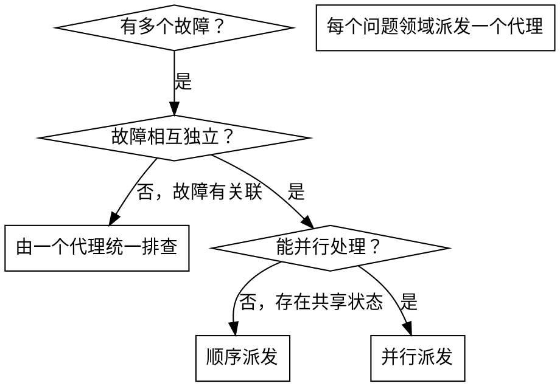

# 并行派发代理

## 概述

将任务委派给上下文相互隔离的专门代理。准备精确的指令和背景，让每个代理
专注于自己的任务。始终按需提供信息，禁止让它们继承当前会话的上下文或历史。
这样也能为你保留协调所需的上下文空间。

如果不同测试文件、不同子系统出现互不相关的故障，逐项排查会耗费更多时间。
这些问题可以各自独立调查，并行处理。

**核心原则** 每个独立的问题领域派发一个代理，各代理并行处理。

## 适用情形



**可以使用的情况**

- 至少三个测试文件有失败，且根因各不相同。
- 多个子系统各自出了问题。
- 无须了解其他问题的背景，即可理解单个问题。
- 各项调查之间没有共享状态。

**避免使用的情况**

- 故障有关联，修复一个可能同时解决其他故障。
- 需要理解整个系统的状态。
- 各代理的操作会相互干扰。

## 操作步骤

### 1. 识别可独立处理的问题

按故障内容分组。

- 文件 A 的测试涉及工具审批流程。
- 文件 B 的测试涉及批量完成行为。
- 文件 C 的测试涉及中止功能。

这些问题相互独立，例如修复工具审批不会影响中止测试。

### 2. 为每个代理明确任务

为每个代理提供以下信息。

- **具体范围** 限于一个测试文件或子系统。
- **明确目标** 使指定测试通过。
- **约束** 不修改其他代码。
- **预期输出** 总结发现和修复内容。

### 3. 并行派发

在同一条回复中派发三个子代理，使它们并行运行。

```text
Subagent (general-purpose): "修复 agent-tool-abort.test.ts 中的失败测试"
Subagent (general-purpose): "修复 batch-completion-behavior.test.ts 中的失败测试"
Subagent (general-purpose): "修复 tool-approval-race-conditions.test.ts 中的失败测试"
# 三个代理并行运行。
```

在同一条回复中进行多次派发会并行执行。每条回复只派发一次则会顺序执行。

### 4. 审查并整合

收到代理的结果后：

- 阅读每份总结。
- 核实修复之间没有冲突。
- 运行完整测试套件。
- 整合所有改动。

## 代理提示的结构

好的代理提示应满足以下要求。

1. **范围集中**，只处理一个明确的问题领域。
2. **信息自足**，包含理解问题所需的全部背景。
3. **输出明确**，讲清楚代理应交回什么。

```markdown
修复 src/agents/agent-tool-abort.test.ts 中的 3 个失败测试。

1. "should abort tool with partial output capture" 预期消息中包含 'interrupted at'
2. "should handle mixed completed and aborted tools" 中执行较快的工具本该完成，却被中止
3. "should properly track pendingToolCount" 预期有 3 个结果，实际有 0 个

这些是时序或竞态问题。按以下步骤处理。

1. 阅读测试文件，弄清楚每个测试在验证什么。
2. 定位根因，判断是时序问题还是实际缺陷。
3. 按根因修复。
   - 用基于事件的等待替换随意设置的超时。
   - 如果中止实现存在缺陷，修复它。
   - 如果测试仍在验证已经变化的行为，调整预期。

不要只延长超时时间，找出实际原因。

返回一份总结，写明发现了什么、修了什么。
```

## 常见错误

**❌ 范围太广** 「修好所有测试」会让代理无从着手。\
**✅ 指定范围** 「修复 agent-tool-abort.test.ts」。

**❌ 缺少背景** 「解决竞态」没说问题在哪里。\
**✅ 提供背景** 附上错误消息和测试名称。

**❌ 缺少约束** 代理可能重构整个系统。\
**✅ 指定约束** 「不要修改生产代码」或「只修改测试」。

**❌ 输出模糊** 「把它修好」没有说明要汇报哪些内容。\
**✅ 指定输出** 「总结根因和改动」。

## 不适用情形

**故障相关** 修复一个可能同时解决其他故障，先放在一起调查。\
**需要完整背景** 必须了解整个系统才能弄清问题。\
**探索性调试** 尚不知道出问题的是哪一部分。\
**共享状态** 代理会相互干扰，例如编辑同一文件或使用同一资源。

## 实际会话示例

**场景** 一次大型重构后，3 个文件中有 6 个测试失败。

**故障**

- agent-tool-abort.test.ts 有 3 个失败，涉及执行时序。
- batch-completion-behavior.test.ts 有 2 个失败，涉及工具未执行。
- tool-approval-race-conditions.test.ts 有 1 个失败，执行次数为 0。

**判断** 中止逻辑、批量完成行为和审批竞态彼此独立。

**派发**

```
代理 1 → 修复 agent-tool-abort.test.ts
代理 2 → 修复 batch-completion-behavior.test.ts
代理 3 → 修复 tool-approval-race-conditions.test.ts
```

**结果**

- 代理 1 用基于事件的等待替换了超时。
- 代理 2 修复了事件结构的缺陷，原来的 threadId 放错了位置。
- 代理 3 增加了等待，确保异步工具执行结束。

**整合** 三项修复相互独立，没有冲突，完整套件全部通过。

## 验证

收到代理结果后：

1. **查看每份总结**，理解各自改了什么。
2. **检查冲突**，确认代理是否改了同一处代码。
3. **运行完整套件**，验证所有修复可以一起工作。
4. **抽查改动**，代理可能犯系统性的错误。
