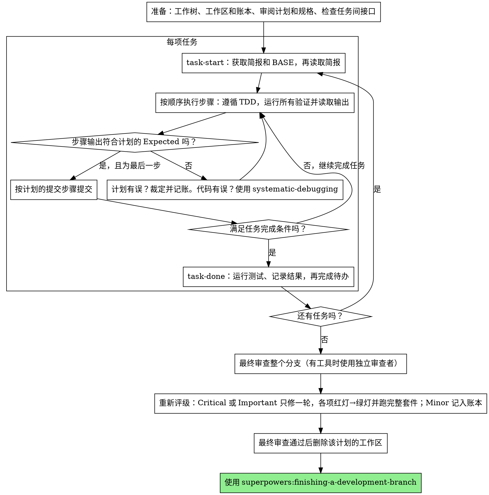

# 执行实施计划

在当前会话中亲自逐项执行计划。每项任务都由你自己实施，
不逐项派发实施者或审查者。最后使用新的上下文审查一次
整个分支。

**为什么在当前会话执行** 子代理驱动开发为每项任务分别派出
新的实施者和审查者，两者都要从头读代码库。
当前会话执行只需要你的上下文，以及最后的一次独立审查。
这样会少掉各项任务独立的上下文和审查。
本技能用其他手段维持质量。任务简报提供准确要求，
进度账本记录已做的工作，TDD 为每项任务把关，
最后由独立审查者复核。

**核心原则** 计划已经给出决策。按计划执行，
亲自观察测试先失败再通过，以此验证各步，
并留下可在上下文丢失后使用的记录。

**过程说明** 两次工具调用之间最多讲一小句。
详细记录留在账本和工具结果里。

**连续执行** 任务之间无需停下来向用户确认。
用户选择在当前会话执行，是为了节省开销。
每项完成后就继续下一项，
直到执行完整份计划。

**作出裁定后继续。** 遇到冲突、歧义或计划缺陷时，作出决定。
以规格为准，计划说明怎样落实规格，两者均未回答时由你判断。
将每项决定按下列格式记入账本，
即 `Ruling: <what you decided> — <why> — <what it costs if wrong>`，再继续。
凡是偏离计划的决定，都要留下记录，
让用户可以核对。

只有四种情况需要暂停。操作不可逆或具有破坏性，
操作涉及安全，操作会在当前工作树之外产生按惯例需先确认的影响
（例如合并、推送到共享分支或发布），或计划缺陷严重到
所有可选做法都只能靠猜测。
遇到这些情况，停下来询问用户。

## 何时使用

- 已有 superpowers:writing-plans 生成的计划，用户在交接时
  选择在当前会话执行。
- 宿主没有子代理工具（见各宿主在
  `../using-superpowers/references/` 中的说明）。切勿虚构派发，
  在当前会话执行。
- 任务大多相互独立。这与
  superpowers:subagent-driven-development 的前提相同。

计划足够具体时，在当前会话里按规格落实并做测试即可。
这适合使用中档模型。最强模型的价值集中在最后的审查，
本技能会为那次审查单独派发。
用户选择当前会话执行时，向他们说明这一点。

如果用户希望每项任务都经过审查，或计划长到后续任务
要在压缩过的上下文中执行，优先使用
superpowers:subagent-driven-development。长计划也能在当前会话执行，
依靠账本可以恢复进度，
但执行越靠后的任务时，可用的上下文越少。

## 流程

## 准备

确保在隔离的工作区里实施。使用
superpowers:using-git-worktrees 创建隔离工作区或确认已有隔离。
在 main 或 master 分支上开始实施之前，
必须得到用户明确同意。

上下文压缩会丢失对话细节。丢失进度后，当前会话的执行者
可能重做已经有提交的任务，就像控制者重复派发任务一样，
开销落在自己的上下文上。用账本文件记录进度。
宿主的待办列表用于查看实时状态，
账本用于留存记录。

工作区和账本与 superpowers:subagent-driven-development 共用，
两者使用相同的目录和格式。因此可以在计划执行途中更换执行者，
由新执行者根据同一份账本续接。

- 每份计划有专属工作区。启动技能时，从正在执行计划的工作树里运行
  `../subagent-driven-development/scripts/sdd-workspace PLAN_FILE`，使用脚本的绝对路径（by its absolute path）。
  脚本会打印该计划专用、
  被 Git 忽略的目录
  （`<repo-root>/.superpowers/sdd/<plan-basename>/`），用来存放
  该计划的账本、简报和审查材料。其他计划的目录
  一律不要读取或写入。
- 在 `<workspace>/progress.md` 检查本计划的账本。如果首行
  指向本计划，有 `Task <N>: complete` 记录的任务都已完成，
  从第一项没有这条记录的任务继续。即使上下文已忘记这些提交，
  Git 中仍有它们的记录。上下文压缩后，
  以账本和 `git log` 为准。
  如果账本首行指向不同的计划文件，
  保留那份账本，另建自己的账本。
- 创建账本时，首行写入计划标识。
  `# SDD ledger — plan: <plan file path>`。
- 工作区是 Git 忽略的临时目录，`git clean -fdx` 会将它删除。
  遇到这种情况，从 `git log` 恢复进度。

先通读一遍计划，记下背景和全局约束（Global Constraints），
为每项任务建一条待办。计划如果引用了规格（Spec），也要阅读。
计划依据该规格，出现冲突时以规格为准。
如果找不到可读取的规格，在账本里说明，
此时作出的裁定都是暂定的。

**必须使用的子技能** 现在加载 superpowers:test-driven-development，
要在任务 1 之前读完。下面每项任务的每个步骤都受它约束。
即便计划已经写明「先编写会失败的测试」，
仍然要读取该技能。

开始任务 1 前，检查计划是否有任务间冲突。依据各任务的
接口栏（Interfaces），凡是依赖前序任务产物的任务，
就在账本记一行，列出双方、提供和使用的接口，以及核对结果。
没有共享内容的任务无需单独记一行。
如果所有任务都不共享接口，只记
`Pre-flight: no shared interfaces`。发现冲突时，以规格为准作出裁定，
把裁定记在对应行旁边，然后开始任务 1。
任务自身的细节留到读取该任务的简报时
再核对。

## 逐项执行任务

打印出的所有内容和每条工具结果，都会占用本会话后续的上下文。
把长测试输出重定向到工作区文件，只读末尾。
执行任务时只读对应简报。

### 1. 开始当前任务

- 在正在执行计划的工作树里运行本技能的 `scripts/task-start PLAN_FILE N`，
  使用脚本的绝对路径（by its absolute path）。它一次就会打印
  简报路径和 BASE（用于确定该任务提交范围的起点）。
  每个任务都要读取简报，包括准备阶段已经看过的任务。
  记忆只是摘要，简报里才有确切的取值、
  签名和测试用例。
- 将该任务的待办标为 in_progress。

每次工具调用都是一次回合，都要重新读取整个上下文。
记账与工作合并进行，例如在提交的同一次调用里追加账本，
避免为记账单独发起调用。

### 2. 按顺序执行步骤

计划已按红灯、绿灯安排步骤。按这个顺序执行，
遵循准备阶段加载的 superpowers:test-driven-development。
测试代码要先写、先运行，亲自观察测试失败是必做步骤。
如果实现还没写，测试就通过了，
应把它视为测试本身的问题。

每个运行命令的步骤都有一行 `Expected:`。
执行命令、读取输出并比对，会有三种结果。

- **符合预期。** 继续下一步。
- **代码有误。** 使用 superpowers:systematic-debugging 找到根因。
  修复应针对根因，不能只把输出改得看起来符合预期。
- **计划有误。** 例如步骤与规格冲突，前序任务的接口
  与当前任务使用的接口不一致，或命令无法运行。
  裁定满足规格的最小变更，并在账本记为
  `Task <N>: Ruling: <finding> — <what you decided and why>`，然后继续。
  后续任务如果涉及同一接口，应从账本读取该裁定，
  以便准确沿用。

按计划里的提交步骤提交。一项任务可以包含多个提交。
审查范围一律从 BASE 起算，不能用 `HEAD~1` 代替。

### 3. 核对任务完成条件

在账本记录任务完成前，以下条件均须满足，
并有本会话中的实际证据佐证。

- 简报列出的每个测试都已存在、本任务中实际运行过，
  而且你读过输出。
- 任务的最终测试通过。这一轮用 `task-done` 运行，
  由脚本把命令和结果写入账本。
- 简报中的每行 `Expected:` 都已与实际输出比对。
- 凡是偏离简报的地方，账本都记录了对应的 `Ruling:`。

**必须使用的子技能** 宣布任务完成时，遵守
superpowers:verification-before-completion。还有缺项时，先补齐再确认完成。

### 4. 完成当前任务

运行本技能的 `scripts/task-done PLAN_FILE N BASE -- <test command>`，
使用脚本的绝对路径（by its absolute path），从正在执行计划的工作树里调用，并传入简报为整个任务指定的测试命令。
脚本运行测试，把完整输出保存在工作区并打印末尾，
只有通过时才将下列完成记录追加到账本。

`Task <N>: complete (commits <base7>..<head7>, tests: <command> → <result>)`

测试失败时，任务继续保持未完成。写入完成记录后，
将待办标为完成，再领取下一项任务。

## 最终审查

运行 `../subagent-driven-development/scripts/review-package PLAN_FILE MERGE_BASE HEAD`，
使用脚本的绝对路径（by its absolute path），从正在执行计划的工作树调用。MERGE_BASE 是分支的起始提交，例如可用
`git merge-base main HEAD` 取得。根据脚本打印的文件开始审查。

**有子代理工具时** 审查整个分支需要独立判断，使用可用的最强模型
派发审查者，
并使用 superpowers:requesting-code-review 的
[code-reviewer.md](../requesting-code-review/code-reviewer.md)。
提供审查材料、计划和规格的路径。计划如果有审查重点（Review Focus），
原样传给审查者，便于逐个核对计划测试未覆盖的输入类别和故障情形。
同时指出账本的 `Ruling:` 记录，
让审查者能评估你作出的裁定。
明确指定模型，省略时会沿用当前会话的模型，
它未必是最强的。这是整个执行过程唯一用到的新上下文。
务必完成这次独立审查，
即使你已经读过自己的差异也要进行。

**没有子代理工具时** 读取 code-reviewer.md。最后一项任务记账后，
单独留出一轮，对照审查材料自行复核。
在账本记入 `Final review: self-review (no subagent tool)`，
并在最终消息说明这是作者自查。自查的独立性较弱，
由用户决定审查程度是否足以
支持合并。

处理前先归类审查发现。审查者的严重性标签是参考，最终由你把关。
「Declined to judge」列表也由你处理，
逐条作出裁定并记入账本，做法与处理计划冲突相同。
记录格式为 `Final: Ruling: <behavior the reviewer set aside> —
<what a reasonable person using this software gets, and why that stands
or why it is now a finding> — <cost if wrong>`。先按实际影响重新评级。
规格描述的是预期目标。分级要依据软件交付后，
用户遇到这些输入会得到怎样的结果。
如果审查者只因规格没提到触发输入就评为 Minor，
就要重新按实际影响来评。评级后按下列方式处理。

- **Critical 和 Important** 纳入本轮修复。
- **Minor** 记入账本，格式为 `Final: minor (deferred): <one-liner>`，
  并列在最终消息的「暂缓的轻微问题」下。轻微问题仅作记录，
  不进入修复轮次。裁定专用于解决冲突，
  暂缓打磨建议只需记为轻微问题。

你是实施者，要亲自用一轮修复处理 Critical 和 Important 发现。
每项修复由 TDD 验证。编写能复现问题的测试，
亲自观察它失败，使其通过，
再运行完整套件。将每项修复记入账本，格式为
`Final: fixed <finding> — <test name> RED→GREEN, suite <N>/<N>`。
必须看到测试先失败，修复才算验证过。完整套件全部通过，
本轮才结束。无需派发复审，
覆盖这些问题的测试已验证修复，完整套件则验证了
是否有回归。

决定不修复的发现要作为裁定，记为 `Final: Ruling: <finding> —
<why the code stands> — <cost if wrong>`，并在裁定列表中告知用户。
修复只进行一轮。

## 收尾

删除任何内容前，将账本中所有含 `Ruling:` 的行按作出裁定的
顺序列在最终消息的「本次裁定」下，并逐项写明误判的代价。
将所有 `minor (deferred)` 行列在「暂缓的轻微问题」下。
两份清单都要完整。最终消息是用户看到你替他们作出的决定，
以及你决定暂缓处理的发现的
唯一途径。

最终审查通过、修复均已提交后，删除本计划的工作区目录。
此时由 Git 历史保存记录。
同级目录属于其他计划，应予以保留。

使用 superpowers:finishing-a-development-branch。

## 常见借口及应对

| 借口 | 实际情况 |
|--------|---------|
| 「我记得 Task N 的内容」 | 你记得的是摘要，准确值都在简报里。读取简报。 |
| 「计划里的代码没错，可以跳过看测试失败」 | 要看到测试实际失败，才能证明它能发现问题。这是一个必做步骤。 |
| 「最后跑完整套件就行，不用每步都跑」 | 逐步运行才能找出是哪一步引发问题。任务结束时的测试也要单独运行。 |
| 「计划这里错了，我按正确的做就行」 | 按正确的做法执行，并把裁定记入账本，使偏离计划的理由可查。 |
| 「先做几项，再一起记账」 | 上下文可能随时压缩。每个任务都要记一行，和提交放在同一次消息里。 |
| 「下一项前先问问用户」 | 用户选择当前会话执行是为了节省开销。只在上述四种情况暂停询问。 |
| 「我仔细看过差异，最终审查者是多余的」 | 作者自查仍可能有同样的盲点，最后的审查者提供唯一一份新上下文。 |
| 「改动很小，测试应该通过」 | 完成条件要求实际运行命令，并读取它的输出。 |
| 「子代理又慢又贵，最后的审查也省掉吧」 | 当前会话执行已经省去逐项独立审查。至少审查一次完整分支。 |
| 「审查者说是 Minor，那就是 Minor」 | 按用户会遭遇的后果重新评估，即使规格未提到，然后决定是否纳入修复。 |
| 「修法很明显，不必先让测试失败」 | 只有先失败再通过的测试才能证明问题确实存在、而且现在已解决。 |
| 「反正都改了，顺手修掉轻微问题」 | 每修一个轻微问题都要额外写测试、修代码、跑完整套件。记入账本，由用户决定。 |
