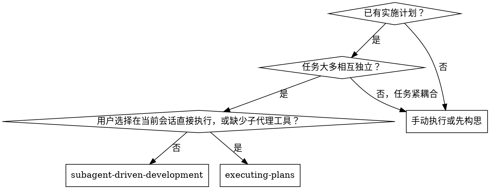
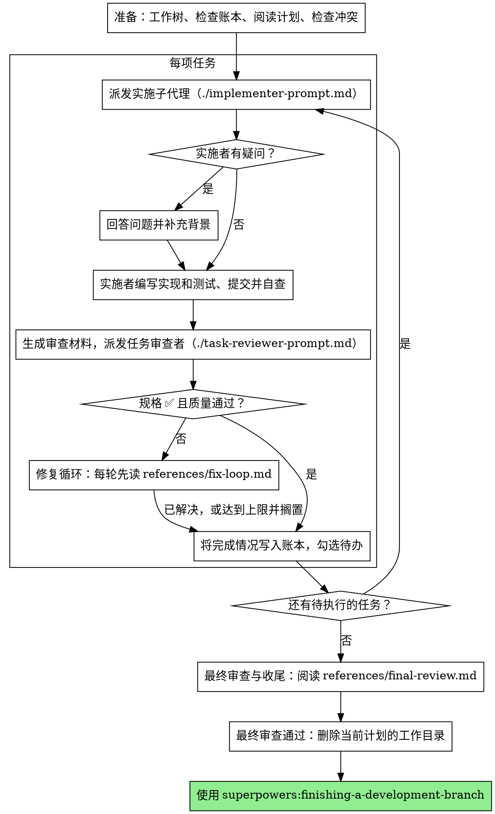

# 子代理驱动开发

执行计划时，每项任务派发一个新的实施子代理。每项任务完成后审查规格符合性和
代码质量，全部任务完成后再对整个分支进行审查。

**使用子代理的理由** 将任务交给上下文相互隔离的专门代理。为每个代理精心准备
指令和背景，让它专注于自己的任务。始终按需提供信息，禁止让代理继承当前
会话的上下文或历史。这样也能为你保留协调所需的上下文空间。

**核心原则** 每项任务由新子代理实施并接受规格与质量审查，最后审查整个分支，
兼顾实现质量和迭代速度。

**过程说明** 两次工具调用之间最多用一条短消息说明进展。详细记录以账本和
工具结果为准。

**连续执行** 任务之间不要停下来询问用户。用户要求执行计划后，就把全部任务
连续执行下去。只有遇到下面列出的四种情况，或全部任务完成，才停止执行。
「要继续吗？」之类的询问和进度总结会占用用户的时间。

**遇到冲突时作出裁定。** 计划运行中遇到冲突、歧义、计划缺陷，或原本需要申请
提高某项上限时，自行判断。规格具有约束力，计划阐述实现理由，两者都无法回答
时由你决定。将每项裁定按
`Ruling: <what you decided> — <why> — <what it costs if wrong>`
记入账本，再继续执行。裁定有误时，用户可以看到记录并撤销改动。停在等待
提问答复的状态只会占用用户的时间。

仅以下四种情况需要停下询问用户：不可逆或破坏性操作、涉及安全的敏感操作、
按惯例须事先询问且会影响当前工作树之外的操作（如合并、推送到共享分支或发布），
以及计划缺陷严重到任意继续路径都只能靠猜测的情况。

## 适用情形

**与 executing-plans（直接执行）的区别**

- 本流程为每项任务使用新的子代理，避免上下文混杂。直接执行在同一上下文完成所有任务。
- 本流程逐项审查规格符合性和代码质量。直接执行在末尾审查。
- 本流程的每项实施和每次审查各占用一个新上下文。直接执行只占用执行上下文和一个最终审查者的上下文。
- 两者均在当前会话推进，共用计划的工作目录和账本，任务之间都连续执行。

## 执行流程

## 准备

使用 superpowers:using-git-worktrees 创建隔离工作区，或确认现有工作区已经隔离。
没有用户的明确同意，禁止在 main 或 master 分支上开始实施。

上下文压缩后，对话记忆可能丢失。曾有协调者失去进度后重新派发所有已完成的任务，
这是实际会话中代价最高的失误。除了待办，还要用账本文件跟踪进度。

- 每份计划有独立的工作目录。启动技能时，在执行计划的工作树中运行本技能的
  `bash scripts/sdd-workspace PLAN_FILE`（使用脚本的绝对路径）。脚本会打印 Git 忽略的计划目录
  （位于 `<repo-root>/.superpowers/sdd/` 下）。将本计划的账本、简报、报告和审查材料
  都存放在此。禁止读写其他计划的目录。
- 查找本计划的账本 `<workspace>/progress.md`。如果存在，先读
  [references/resuming.md](references/resuming.md)，确认账本归属和恢复位置。
- 新建账本时，将计划标识写在首行。
  `# SDD ledger — plan: <plan file path>`。
- 即使上下文已经忘记创建过哪些提交，账本记下的提交仍在 Git 中。上下文压缩后，
  以账本和 `git log` 为准。
- `git clean -fdx` 会删除这个被 Git 忽略的临时目录。如果发生这种情况，
  通过 `git log` 恢复进度。

通读一次计划，记下背景和全局约束（Global Constraints），为每项任务添加一条
待办。如果计划指明了规格（Spec），也要读规格。计划根据规格说明实现理由，
出现冲突时以规格为准。如果找不到可读取的规格，在账本注明，此时作出的裁定
都是暂定的。

派发第 1 项任务前，阅读 [references/preflight.md](references/preflight.md)
并完成其中的冲突检查。把检查表和裁定写入账本。

## 模型选择

为每种角色选择能胜任的最低档模型，控制成本和用时。

**机械性的实施任务**（独立函数、规格明确、涉及 1 至 2 个文件），使用快速、
低成本的模型。计划足够明确时，多数实施任务都属于这一类。

**需要集成和判断的任务**（协调多个文件、匹配既有模式、调试），使用标准档模型。

**架构和设计任务**使用目前能力最强的模型。整个分支的最终审查也属于这一类，
明确选择目前最强的模型，别沿用会话默认值。

**审查任务**采用同样的判断方法，按差异规模、复杂度和风险选择模型。
机械性的小改动无需最高档模型，微妙的并发改动则需要。小范围修复的复审
可以使用低成本至中档模型。

**修复循环升级（第 4 至 5 轮）** 使用至少比受阻实施者高一档的模型。

**派发子代理时始终显式指定模型。** 省略模型时，子代理会沿用当前会话的模型，
通常是能力最强且最昂贵的一档。

**轮次比单次 token 价格更影响成本。** 实际用时和上下文成本随子代理的执行轮次
增长。最低档模型处理多步骤工作时经常需要 2 至 3 倍轮次，总成本反而更高。
审查者和依据文字说明实施的子代理至少使用中档模型。如果计划已经给出了完整代码，
实施只需照写和测试，使用最低成本的模型。单文件的机械性修复同样使用最低档模型。

**实施任务的复杂度判断**

- 规格完整且涉及 1 至 2 个文件 → 低成本模型
- 跨多个文件且要考虑集成 → 标准档模型
- 需要设计判断或广泛理解代码库 → 能力最强的模型

## 单项任务循环

**同类小改动** 如果计划在不同文件中列出多项小而相似的改动，派发前先读
[references/batching.md](references/batching.md)。

粘贴到派发提示中的内容和子代理在消息中返回的内容，都会留在当前会话里，
并在后续轮次被反复读取。用文件交接材料。

**等待子代理** 禁止对等待接口进行短超时轮询，也不要无声地无限期等待。
还有本地工作时，继续更新账本、生成下一份审查材料或读报告，子代理结果会
自动送达。确实无事可做时，分段等待。在宿主允许的情况下，每段为五到十分钟。
每段之间发一行状态，列出仍在运行的子代理，并追踪已完成但尚未汇报的子代理。
有界等待能保留长时间等待的大部分效率，又能在几分钟内发现卡住或失联的子代理。

### 1. 派发实施者

派发前记录 BASE（`git rev-parse HEAD`）。审查材料和修复轮次的差异需要这个基准。

- **任务简报** 派发实施者前，在执行计划的工作树中运行本技能的
  `bash scripts/task-brief PLAN_FILE N`（使用脚本的绝对路径）。脚本会将任务完整原文提取到唯一命名的文件
  中并打印路径。派发时让简报成为需求的唯一来源，并提供以下信息。
  （1）用一行说明任务在项目中的位置。
  （2）给出简报路径并说明「先读这份文件。里面是需求，确切值必须原样使用」。
  （3）说明简报无法涵盖的前序任务接口或裁定。
  （4）说明如何处理你在简报中发现的歧义。
  （5）提供报告文件路径和报告格式。
  确切值只在简报中出现，包括数值、魔法字符串、签名、测试用例。禁止让子代理
  读取整份计划。
- **报告文件** 按简报名命名实施者报告，把路径放入派发提示
  （简报 `…/task-N-brief.md` → 报告 `…/task-N-report.md`）。
  实施者把完整报告写入该文件，只简短返回状态、提交、一行测试摘要、疑虑和报告路径。
- 派发提示只描述一项任务。禁止在后续派发里粘贴累计的前序任务总结，例如
  「第 1 至 3 项任务后的状态」。曾有会话的一份派发提示长达 4.2 万字符，其中
  99% 是粘贴的历史。新的子代理只需要了解自己的任务、会涉及的接口和全局约束。
- 派发时附上模板中禁止另派子代理的要求。实施者不得派发帮手或审查者。
  收到报告后由你派发审查。实际会话中，实施者自行派发的每次审查都重复了
  协调者安排的任务审查，每项任务因此多花了一次完整审查的成本。
- 如果前序任务搁置了当前任务所涉及区域的问题，在派发提示里指出相应账本记录。
- 记录派发结果中的实施者标识，修复循环第 1 至 3 轮会恢复这个代理。
- 禁止同时派发多个实施子代理，以免引起冲突。

模板见 [implementer-prompt.md](implementer-prompt.md)。

### 2. 处理报告

实施子代理会报告四种状态之一，按状态处理。

**DONE** 生成审查材料。在执行计划的工作树中运行
`bash scripts/review-package PLAN_FILE BASE HEAD`（使用脚本的绝对路径）。脚本会打印唯一的文件路径。
BASE 是派发前记录的提交，严禁用 `HEAD~1`，它会漏掉多提交任务的前序提交。
随后用打印的路径派发任务审查者。

**任何其他状态**（DONE_WITH_CONCERNS、NEEDS_CONTEXT、BLOCKED），每次收到时
都要阅读并按 [references/handling-reports.md](references/handling-reports.md)
处理。

实施者在开始前或实施中提出问题时，完整、清楚地回答，按需补充背景，
不要催促它开始实施。

### 3. 审查任务

任务审查只验收该项任务。完整的分支审查在最终阶段做一次。任务审查不可跳过，
必须同时有规格符合性和任务质量两项结论，缺少任一项的报告都不能接受。
实施者自查后仍要接受任务审查。

- 将差异作为文件交给审查者。在执行计划的工作树中运行本技能的
  `bash scripts/review-package PLAN_FILE BASE HEAD`（使用脚本的绝对路径），把脚本打印的路径交给审查者。
  没有 Bash 时，运行相应范围的 `git log --oneline`、`git diff --stat` 和
  `git diff -U10`，将输出重定向到一个唯一命名的文件。材料内容不进入你的上下文，
  审查者通过一次 Read 调用即可看到提交列表、统计摘要和带上下文的完整差异。
  使用派发实施者前记录的 BASE，严禁用 `HEAD~1` 截断多提交任务的差异。
  禁止在没有差异文件的情况下派发任务审查。
- **审查者的输入**是三个路径和约束任务的全局约束。三个路径分别对应
  同一份任务简报、实施报告和审查材料。
- 全局约束用于告诉审查者本项目要核对什么。从计划「全局约束（Global Constraints）」
  一节或规格中原样复制约束性需求，包括精确值、确切格式和组件之间明文规定的关系，
  例如「布局与 X 相同」「与 Y 一致」。YAGNI、测试规范和审查方法等流程规则
  已写在审查者模板里。
- 没有具体且与任务相关的理由时，避免「检查所有用法」或「有必要就跑竞态测试」
  一类开放式指令。
- 不要要求审查者重跑实施者已在同一份代码上运行的测试。测试证据在实施者报告里。
- 别为审查者预判结果，也不要要求它忽略某个问题或不要指出该问题。怀疑某项
  发现会是误报时，先让审查者提出，再按审查循环处理。如果你正写入「不要指出」
  「别把 X 当成缺陷」「至多定为 Minor」或「计划已选定」，立即停下来。
  这样做是在预判，通常只是为了少做一轮审查。

如果审查者报告「⚠️ Cannot verify from diff」事项，标记任务完成前先读
[references/cannot-verify.md](references/cannot-verify.md)。

模板见 [task-reviewer-prompt.md](task-reviewer-prompt.md)。

### 4. 修复循环

审查给出规格 ❌、任何 Critical 或 Important 发现，或你确认某项 ⚠️ 确有缺漏时，
进入修复循环。

每次触发时阅读并遵循 [references/fix-loop.md](references/fix-loop.md)。
即使本会话之前读过，也要在每一轮开始前重读。里面规定了轮次上限、达到上限后的
处理方法和每轮账本格式，而上下文压缩后记忆可能丢失。

### 5. 完成任务

审查确认没有问题时，或已达到上限且所有未解决的发现都已裁定并搁置时，
在处理其他记录的同一条消息里将完成情况写入账本。

- `Task <N>: complete (commits <base7>..<head7>, review clean)`
- 达到上限并裁定后，记作 `Task <N>: complete (commits <base7>..<head7>, <K> parked)`。

再勾选待办并继续。只要还有 Critical 或 Important 发现既未修复、又未在达到
上限时裁定并搁置，就不能进入下一项任务。

## 最终审查

全部任务完成后，阅读并遵循 [references/final-review.md](references/final-review.md)。
其中说明如何审查整个分支、进行唯一一轮修复并收尾。

## 常见借口及应对

| 借口 | 实际要求 |
|--------|---------|
| 「基本符合规格就够了」 | 审查者发现规格缺漏，任务就还没完成。修复问题，或到达上限后裁定。 |
| 「我自己修更快，派发太费事了」 | 协调者自行修复会占用协调上下文，还会绕过审查。继续使用原实施者。 |
| 「再来一轮就能解决」 | 超过上限仍无法收敛，说明问题出在流程或方案本身。作出裁定并安排后续处理。 |
| 「审查者反正还会找出新问题」 | 复审只验证修复。未改动代码里的新发现记入账本，不延长循环。 |
| 「这条发现显然有误，直接丢掉吧」 | 只有达到上限才裁定，并将每项裁定写入账本。禁止悄悄丢弃发现。 |
| 「改动很小，跳过复审吧」 | 未复审的修复可能引入回归。每轮都要以限定范围的复审结束。 |
| 「审查拖慢了修复」 | 审查用于检验每轮改动并决定下一轮需要修什么。 |
| 「记账太费事」 | 账本能在上下文压缩后恢复进度。曾有协调者没有账本，重新派发了一整批已完成的任务。 |
| 「实施者自己派了审查者，相当于多一重保障」 | 它重复检查同一份差异，仍需通过正式任务审查。应指出违规派发审查者的问题。 |
