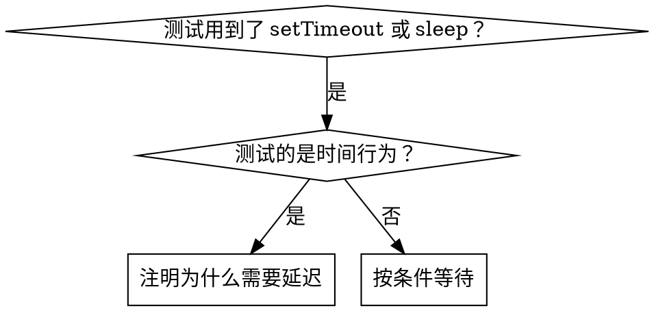

# 按条件等待

## 概述

不稳定的测试往往用固定延迟来猜测操作完成的时间。这样容易引入竞态条件，导致测试在快机器上通过，在高负载或 CI 环境中失败。

**核心原则** 等到真正关注的条件成立，避免猜测它需要多久。

## 何时使用



适用情况：

- 测试含有固定延迟（`setTimeout`、`sleep`、`time.sleep()`）。
- 测试时好时坏，负载高时会失败。
- 测试并行运行时超时。
- 需要等待异步操作完成。

测试防抖或节流间隔等时间行为时，可使用固定延迟，但始终要写明原因。

## 基本用法

```typescript
// ❌ 改动前：猜测耗时
await new Promise(r => setTimeout(r, 50));
const result = getResult();
expect(result).toBeDefined();

// ✅ 改动后：等待条件成立
await waitFor(() => getResult() !== undefined);
const result = getResult();
expect(result).toBeDefined();
```

## 常用示例

| 场景 | 写法 |
| --- | --- |
| 等待事件 | `waitFor(() => events.find(e => e.type === 'DONE'))` |
| 等待状态 | `waitFor(() => machine.state === 'ready')` |
| 等待达到数量 | `waitFor(() => items.length >= 5)` |
| 等待文件 | `waitFor(() => fs.existsSync(path))` |
| 等待组合条件 | `waitFor(() => obj.ready && obj.value > 10)` |

## 实现

通用轮询函数：

```typescript
async function waitFor<T>(
  condition: () => T | undefined | null | false,
  description: string,
  timeoutMs = 5000
): Promise<T> {
  const startTime = Date.now();
  while (true) {
    const result = condition();
    if (result) return result;

    if (Date.now() - startTime > timeoutMs) {
      throw new Error(`Timeout waiting for ${description} after ${timeoutMs}ms`);
    }
    await new Promise(r => setTimeout(r, 10)); // 每 10ms 轮询一次
  }
}
```

同目录的 `condition-based-waiting-example.ts` 有完整实现，包括来自实际调试的专用辅助函数 `waitForEvent`、`waitForEventCount` 和 `waitForEventMatch`。

## 常见错误

- **❌ 轮询太频繁。** `setTimeout(check, 1)` 浪费 CPU。**✅** 改为每 10ms 轮询一次。
- **❌ 缺少超时。** 条件一直不满足就会无限循环。**✅** 设置超时并给出清晰的错误信息。
- **❌ 读取旧数据。** 在循环前缓存状态。**✅** 在循环内调用 getter 获取最新数据。

## 固定延迟的适用情况

```typescript
// 工具每 100ms 执行一次，需要经过两次才能验证部分输出
await waitForEvent(manager, 'TOOL_STARTED'); // 先等待触发条件
await new Promise(r => setTimeout(r, 200));   // 再等待要测试的时间行为
// 200ms 对应两次 100ms 间隔，已写明依据
```

1. 先等待触发条件成立。
2. 按已知的时间间隔设置延迟。
3. 在注释中说明原因。

## 实际效果

2025-10-03 的调试会话中：

- 修复了 3 个文件中 15 项不稳定测试。
- 测试通过率从 60% 提升至 100%。
- 执行耗时缩短 40%。
- 竞态条件消失。
