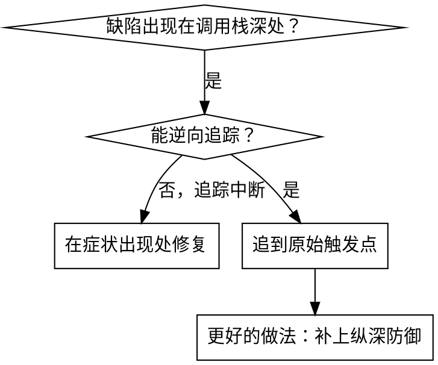
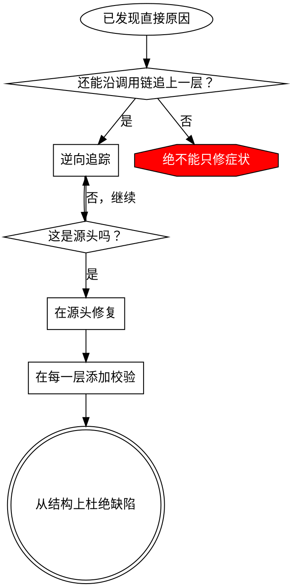

# 根因追踪

## 概述

缺陷常在调用栈深处暴露，例如 `git init` 在错误目录运行、文件创建到错误位置或数据库使用了错误路径。在报错处动手只能处理眼前的症状。

**核心原则** 沿调用链逆向追踪，找到原始触发点后在源头修复。

## 何时使用



- 错误出现在执行过程深处，距离入口很远。
- 堆栈显示调用链很长。
- 无法确定无效数据的来源。
- 需要找出触发问题的测试或代码。

## 追踪过程

### 1. 观察症状

```text
Error: git init failed in ~/project/packages/core
```

### 2. 找到直接原因

**哪段代码直接触发了错误？**

```typescript
await execFileAsync('git', ['init'], { cwd: projectDir });
```

### 3. 查看调用方

```text
WorktreeManager.createSessionWorktree(projectDir, sessionId)
  ← Session.initializeWorkspace() 调用
  ← Session.create() 调用
  ← 测试在 Project.create() 处调用
```

### 4. 继续往上追踪

**当时传入的值是什么？**

- `projectDir = ''`（空字符串）。
- `cwd` 为空字符串时会解析成 `process.cwd()`。
- 结果使用了源码目录。

### 5. 找到原始触发点

**空字符串从哪里来？**

```typescript
const context = setupCoreTest(); // 返回 { tempDir: '' }
Project.create('name', context.tempDir); // 在 beforeEach 之前访问了 tempDir
```

## 添加堆栈跟踪

手动追踪困难时，加上调试记录。

```typescript
// 在有问题的操作前记录堆栈
async function gitInit(directory: string) {
  const stack = new Error().stack;
  console.error('DEBUG git init:', {
    directory,
    cwd: process.cwd(),
    nodeEnv: process.env.NODE_ENV,
    stack,
  });

  await execFileAsync('git', ['init'], { cwd: directory });
}
```

**关键点** 在测试中用 `console.error()`，日志框架的输出可能会被隐藏。

运行测试并捕获输出：

```bash
npm test 2>&1 | grep 'DEBUG git init'
```

分析堆栈：

- 查找测试文件名。
- 定位触发调用的行号。
- 找出规律，例如反复出现的测试或参数。

## 确定哪个测试污染了环境

测试期间出现意外文件却不清楚是哪个测试造成的，用同目录的 `find-polluter.sh` 逐项定位。

```bash
bash ./find-polluter.sh '.git' 'src/**/*.test.ts'
```

脚本逐个运行测试，找到首个污染源后停止。用法见脚本。

## 实际案例：空的 projectDir

**症状** `.git` 被创建在源码目录 `packages/core/` 中。

**调用链**

1. `git init` 在 `process.cwd()` 中运行，因为 `cwd` 参数为空。
2. `WorktreeManager` 收到了空的 `projectDir`。
3. `Session.create()` 传入了空字符串。
4. 测试在 `beforeEach` 前访问了 `context.tempDir`。
5. `setupCoreTest()` 初始返回 `{ tempDir: '' }`。

**根因** 顶层变量初始化时读取了尚未设置的值。

**修复** 将 `tempDir` 改为 getter，若在 `beforeEach` 之前访问则抛出错误。

**补充纵深防御**

- 第 1 层。`Project.create()` 校验目录。
- 第 2 层。`WorkspaceManager` 确认参数非空。
- 第 3 层。通过 `NODE_ENV` 在测试中阻止在临时目录之外运行 `git init`。
- 第 4 层。在 `git init` 前记录堆栈。

## 修复原则



**要修复报错，先向上追踪，找到原始触发点。**

## 堆栈跟踪建议

- **测试中**使用 `console.error()`，日志框架的输出可能被隐藏。
- **在有风险的操作之前**记录日志，以免失败后丢失现场。
- **记录上下文**，包括目录、`cwd`、环境变量和时间戳。
- **捕获堆栈**。`new Error().stack` 会显示完整调用链。

## 实际效果

2025-10-03 的调试会话中：

- 沿调用链向上追了 5 层，找到根因。
- 在源头加入 getter 校验。
- 添加了 4 层防御。
- 1847 项测试通过，未再出现污染。
