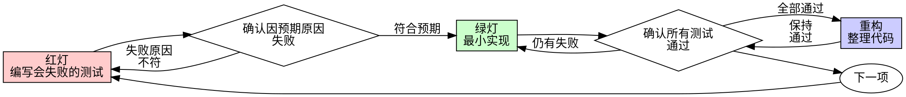

# 测试驱动开发（TDD）

## 概述

先写测试，亲自确认它失败，再编写让它通过的最少代码。

**核心原则** 只有亲自看到测试失败，才能确认它能捕捉到你想验证的问题。

**违反规则的明文要求，就违背了规则的宗旨。**

## 何时使用

**以下情况都要使用**
- 新功能
- 缺陷修复
- 重构
- 行为变更

**例外情况（先询问用户）**
- 用完即弃的原型
- 自动生成的代码
- 配置文件

如果你在想「就这一次跳过 TDD」，先停下来。这是在给自己找借口。

## 铁律

```
先写测试并确认它失败，再写生产代码
```

如果在测试之前写了实现代码，删掉这份实现，重新开始。

**一律如此**
- 别留着当「参考」
- 别一边写测试一边「改写」它
- 别回去看那份代码
- 删除就是把它删掉

从测试出发重新实现。就按这个顺序做。

## 红灯、绿灯、重构



### 红灯：编写会失败的测试

写一条最小的测试，明确应该发生什么。

<Good>
```typescript
test('retries failed operations 3 times', async () => {
  let attempts = 0;
  const operation = () => {
    attempts++;
    if (attempts < 3) throw new Error('fail');
    return 'success';
  };

  const result = await retryOperation(operation);

  expect(result).toBe('success');
  expect(attempts).toBe(3);
});
```
名称清晰，只检验一项真实行为。
</Good>

<Bad>
```typescript
test('retry works', async () => {
  const mock = jest.fn()
    .mockRejectedValueOnce(new Error())
    .mockRejectedValueOnce(new Error())
    .mockResolvedValueOnce('success');
  await retryOperation(mock);
  expect(mock).toHaveBeenCalledTimes(3);
});
```
名称含糊，只检验了 mock 的行为。
</Bad>

**要求**
- 只检验一项行为
- 名称清晰
- 测试真实代码（只有避不开时才使用 mock）

### 验证红灯：亲自确认失败

**必须执行，绝不能跳过。**

```bash
npm test path/to/test.test.ts
```

确认以下几点。
- 测试产生预期的断言失败，测试运行器正常执行
- 失败信息符合预期
- 失败由缺少功能引起，已排除拼写错误等无关原因

**如果测试通过了** 说明测试测到了已有行为，需要调整测试。

**如果测试运行报错** 先解决报错，再重跑，直到测试因预期原因失败。

### 绿灯：编写最小实现

用最简单的代码让测试通过。

<Good>
```typescript
async function retryOperation<T>(fn: () => Promise<T>): Promise<T> {
  for (let i = 0; i < 3; i++) {
    try {
      return await fn();
    } catch (e) {
      if (i === 2) throw e;
    }
  }
  throw new Error('unreachable');
}
```
实现刚好足以让测试通过。
</Good>

<Bad>
```typescript
async function retryOperation<T>(
  fn: () => Promise<T>,
  options?: {
    maxRetries?: number;
    backoff?: 'linear' | 'exponential';
    onRetry?: (attempt: number) => void;
  }
): Promise<T> {
  // YAGNI
}
```
过度设计。
</Bad>

把改动限定在测试所需的范围内。添加额外功能、重构其他代码或「顺手改进」都留到另行处理。

### 验证绿灯：亲自确认通过

**必须执行。**

```bash
npm test path/to/test.test.ts
```

确认以下几点。
- 新测试通过
- 其他测试仍然通过
- 输出没有错误或警告

**如果测试失败** 修正实现代码，保留测试中约定的行为。

**如果其他测试失败** 立即处理。

**「其他测试」指项目的完整测试套件。** 新写的测试通过后，
还要确认整个套件的结果。在宣称改动完成前，即使任务只涉及
一个测试文件，也要运行项目的测试命令（例如直接运行 `pytest`、
`npm test` 或 `cargo test`，以仓库使用的命令为准）。
任务的范围约束交付内容，验证仍须覆盖完整套件。
报告中要逐一写出本轮失败的测试名称，
包括与本次改动无关的失败。
如果看到了测试失败却略过不提，
报告就失实了。

### 重构：整理代码

只有测试全部通过后才开始。
- 去除重复
- 改进命名
- 提取辅助函数

保持测试通过和现有行为。

### 重复

为下一项功能编写下一条会失败的测试。

## 好测试的特征

| 特征 | 好的做法 | 不好的做法 |
|---------|------|-----|
| **精简** | 只检验一项行为。名称里有「以及」就拆开。 | `test('validates email and domain and whitespace')` |
| **清晰** | 用名称描述所检验的行为 | `test('test1')` |
| **说明意图** | 展示预期的 API 用法 | 让人看不出代码应该做什么 |

编写或修改任何测试时，阅读 [writing-good-tests.md](writing-good-tests.md)，了解如何确保测试有效。
- 动笔前先说明生产代码发生什么变化会使这个测试失败
- 断言要针对真实行为，禁止对 mock 本身的行为作断言
- 只供测试使用的代码放在测试工具中，避免放进生产类
- 模拟依赖之前，先了解它的副作用

## 常见借口及应对

| 借口 | 实际情况 |
|--------|---------|
| 「太简单了，用不着测试」 | 简单的代码也会出错，写个测试只要 30 秒。 |
| 「写完再测试」 | 后补的测试可能一运行就通过，这无法证明它能发现问题。它可能测错对象、只验证实现细节，或漏掉你忘记的边界情况。先看到它失败，才能证明它确实能捕捉那个缺陷。先写测试会迫使你验证这次失败。 |
| 「后补测试也能达到目的，重在精神」 | 后补测试回答「代码做了什么」，先写测试回答「代码应该做什么」。已有实现会影响你后补的测试，让你只检查已经想到的用例，错过原本可能发现的用例。这样有了覆盖率，却没证明测试真的有效。 |
| 「已经手动测过了」 | 临时手测通常没有覆盖记录，代码改动后难以按原步骤重跑，时间紧时也容易漏掉用例。「我试过，能用」只能说明那一次的结果。自动化测试每次都会按相同的方式执行。 |
| 「删掉花了 X 小时写的代码太浪费了」 | 这是沉没成本谬误，那些时间已经花掉了。按 TDD 重写能获得较高的信心，留下旧代码再补测试则难以建立信心，还可能留下缺陷。保留无法信赖的代码才是浪费。 |
| 「留着当参考，还是先写测试」 | 你很可能会照着它改，那就成了事后补测试。删除就是把它删掉。 |
| 「得先探索一下」 | 可以先探索。丢弃探索代码，再从 TDD 开始。 |
| 「测试难写，说明设计不清楚」 | 重视测试发出的信号。难测试的接口也很难用。 |
| 「TDD 会拖慢进度」 | TDD 能在提交前发现缺陷、防止回归，让你放心重构。看似务实的捷径会把调试留到生产环境，反而拖慢进度。 |
| 「手测更快」 | 手测难以证实边界情况。每次改动后还得重新手测。 |
| 「原有代码就没有测试」 | 既然要改进它，就为现有代码补上测试。 |

## 遇到警示信号就停下并重来

- 在测试前写了代码
- 实现写完才写测试
- 测试一运行就通过
- 解释不了测试为什么失败
- 把测试留到「之后再补」
- 给自己找「就这一次」的借口
- 「我已经手动测过了」
- 「事后补测试也能达到同样目的」
- 「重在精神，形式无所谓」
- 「留着当参考」或「改一下已有代码」
- 「已经花了 X 小时，删了太浪费」
- 「TDD 太教条，我这是务实」
- 「这次情况不同，因为……」

**遇到其中任何一项，就删除实现代码，从 TDD 重新开始。**

## 示例：修复缺陷

**缺陷** 表单接受了空邮箱。

**红灯**
```typescript
test('rejects empty email', async () => {
  const result = await submitForm({ email: '' });
  expect(result.error).toBe('Email required');
});
```

**验证红灯**
```bash
$ npm test
FAIL: expected 'Email required', got undefined
```

**绿灯**
```typescript
function submitForm(data: FormData) {
  if (!data.email?.trim()) {
    return { error: 'Email required' };
  }
  // ...
}
```

**验证绿灯**
```bash
$ npm test
PASS
```

**重构**
如有需要，提取供多个字段共用的校验逻辑。

## 验证清单

在标记工作完成前，逐项确认。

- [ ] 每个新函数或方法都有测试
- [ ] 实施前亲自看到每条新测试失败
- [ ] 每条测试都因预期原因失败（缺少功能，已排除拼写错误）
- [ ] 为每条测试编写了足以让它通过的最少代码
- [ ] 所有测试均通过
- [ ] 输出没有错误或警告
- [ ] 测试使用真实代码（只有避不开时才使用 mock）
- [ ] 覆盖了边界情况和错误路径

如果有任何一项无法勾选，说明跳过了 TDD 的步骤，重新开始。

## 遇到困难时

| 问题 | 处理办法 |
|---------|----------|
| 不知道怎么测试 | 写出期望的 API 用法，先写断言，也可以向用户请教。 |
| 测试太复杂 | 设计过于复杂，简化接口。 |
| 所有东西都得模拟 | 代码耦合过紧，使用依赖注入。 |
| 测试准备工作太多 | 提取辅助函数。如果仍然复杂，简化设计。 |

## 与调试结合

发现缺陷时，先写一条能复现它的失败测试，再按 TDD 循环修复。测试能证明修复有效，并防止回归。

修复缺陷前必须先有测试。

## 最终规则

```
编写生产代码 → 已经先写了测试并看到它失败
缺少这一步 → 不符合 TDD
```

任何例外都须经用户同意。
