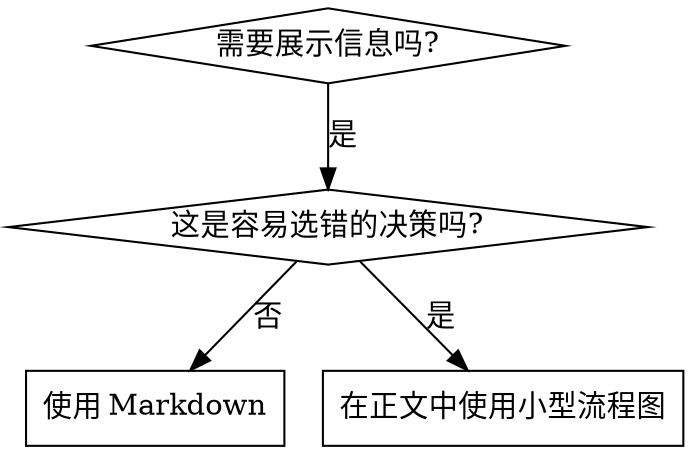

# 技能中的流程图

这是 superpowers:writing-skills 的参考资料。

## 何时使用流程图



仅在以下情况使用流程图：

- 做法不直观的决策点。
- 容易过早停止的流程循环。
- 需要决定何时用 A、何时用 B。

参考资料用表格或列表，代码示例用 Markdown 代码块，线性指令用编号列表。流程图中的标签要表达实际含义，避免使用 step1 或 helper2 之类的名字。

Graphviz 样式规则见同目录的 `graphviz-conventions.dot`。

需要向用户展示流程图时，在 writing-skills 目录下运行 `render-graphs.js`，将指定技能中的流程图渲染为 SVG：

```bash
node ./render-graphs.js ../some-skill           # 每张图分别输出
node ./render-graphs.js ../some-skill --combine # 合并到一个 SVG
```
